# Скиллы для мультфильмов с skills.sh

Подборка скиллов для ИИ-агентов (Claude Code, Codex, Cursor и др.), которые помогают делать **мультфильмы и анимацию персонажей**: от раскадровки и рига до готового мульта. Всего 30 скиллов. Сначала идут 7 скиллов с примерами картинок, потом блок «Без примеров».

> [!TIP]
> Нажми на картинку в каталоге, чтобы перейти к скиллу. Как выбрать и поставить скилл, написано в конце, в разделе [«Что делать»](#что-делать).

## Каталог

<table>
<tr>
<td align="center" width="25%"><a href="#s01">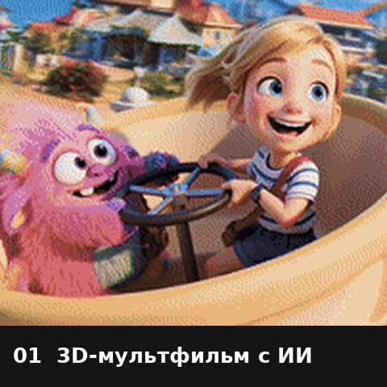</a> <b>01</b> 3D-мультфильм с ИИ</td>
<td align="center" width="25%"><a href="#s02">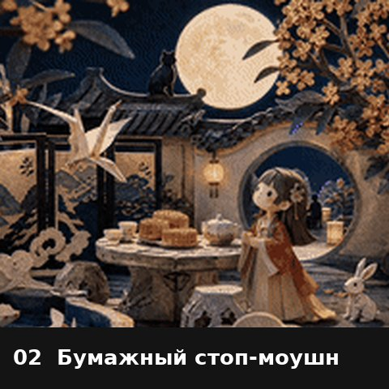</a> <b>02</b> Бумажный стоп-моушн</td>
<td align="center" width="25%"><a href="#s03">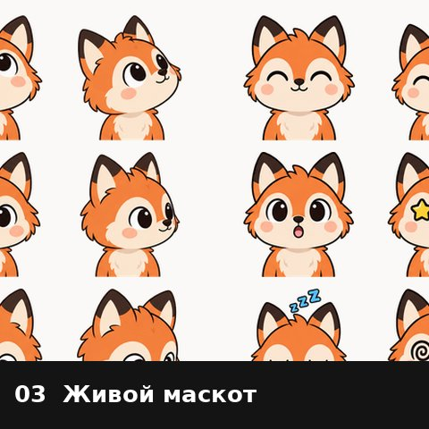</a> <b>03</b> Живой маскот</td>
<td align="center" width="25%"><a href="#s04">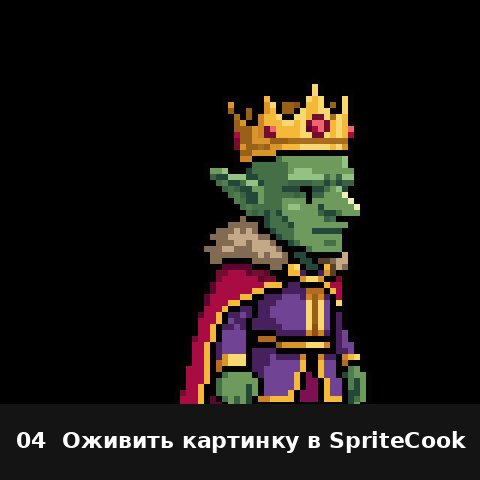</a> <b>04</b> Оживить картинку в SpriteCook</td>
</tr>
<tr>
<td align="center" width="25%"><a href="#s05">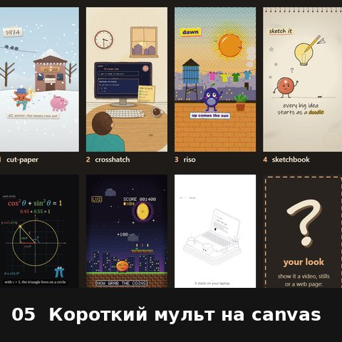</a> <b>05</b> Короткий мульт на canvas</td>
<td align="center" width="25%"><a href="#s06">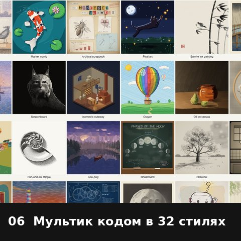</a> <b>06</b> Мультик кодом в 32 стилях</td>
<td align="center" width="25%"><a href="#s07">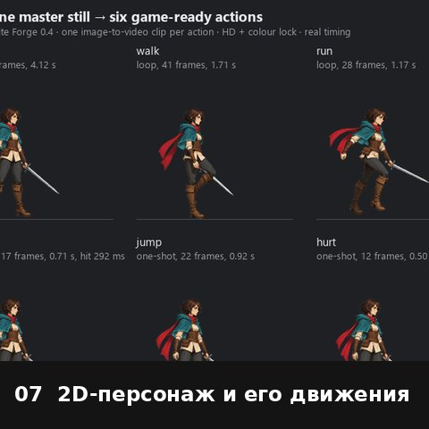</a> <b>07</b> 2D-персонаж и его движения</td>
</tr>
</table>

## Скиллы с примерами

### 01. 3D-мультфильм с ИИ · `3d-animation-short-generator`

**Хочешь 3D-мульт от идеи до готового ролика с одними и теми же героями в каждом кадре — иди сюда.**

- **Что внутри:** 3D, стилизованный; ИИ-генерация видео по шотам + сборка с музыкой; работает только в агенте MiniMax Hub
- **Цифры:** установок на skills.sh 3 785, звёзд у репозитория 11 883 (звёзды у всей коллекции MiniMax H3)
- **Ссылки:** [папка скилла на GitHub](https://github.com/minimax-ai/minimax-h3/tree/HEAD/skills/3d-animation-short-generator) · [страница на skills.sh](https://skills.sh/minimax-ai/minimax-h3/3d-animation-short-generator)
- **Последнее изменение папки скилла:** 10.08.2026
- **Установка:** `npx skills add https://github.com/minimax-ai/minimax-h3 --skill 3d-animation-short-generator`

<a href="https://github.com/minimax-ai/minimax-h3/blob/HEAD/assets/3d-animation-short-generator.gif">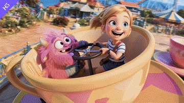</a>

Пример из README ([источник](https://github.com/minimax-ai/minimax-h3/blob/HEAD/assets/3d-animation-short-generator.gif))

[↑ к каталогу](#каталог)

### 02. Бумажный стоп-моушн · `papercraft-stop-motion-explainer`

**Хочешь объясняющий ролик, где бумажные персонажи двигаются в декорациях из бумаги — иди сюда.**

- **Что внутри:** стоп-моушн из бумаги; персонажи, декорации, раскадровка, промпты для картинок и видео; научпоп и обучение
- **Цифры:** установок на skills.sh 3 588, звёзд у репозитория 11 883 (звёзды у всей коллекции MiniMax H3)
- **Ссылки:** [папка скилла на GitHub](https://github.com/minimax-ai/minimax-h3/tree/HEAD/skills/papercraft-stop-motion-explainer) · [страница на skills.sh](https://skills.sh/minimax-ai/minimax-h3/papercraft-stop-motion-explainer)
- **Последнее изменение папки скилла:** 10.08.2026
- **Установка:** `npx skills add https://github.com/minimax-ai/minimax-h3 --skill papercraft-stop-motion-explainer`

<a href="https://github.com/minimax-ai/minimax-h3/blob/HEAD/assets/papercraft-stop-motion-explainer.gif">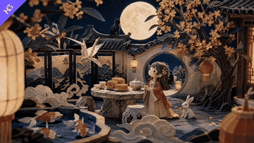</a>

Пример из README ([источник](https://github.com/minimax-ai/minimax-h3/blob/HEAD/assets/papercraft-stop-motion-explainer.gif))

[↑ к каталогу](#каталог)

### 03. Живой маскот · `page-mascot`

**Хочешь мультяшного маскота, который поворачивает голову и строит рожицы — иди сюда.**

- **Что внутри:** 2D, чиби; 9 поворотов головы + 9 эмоций; 52 готовых персонажа или свой
- **Цифры:** установок на skills.sh 1 486, звёзд у репозитория 1 378
- **Ссылки:** [папка скилла на GitHub](https://github.com/nilbuild/page-mascot/tree/HEAD/skills/page-mascot) · [страница на skills.sh](https://skills.sh/nilbuild/page-mascot/page-mascot)
- **Последнее изменение папки скилла:** 15.09.2026
- **Установка:** `npx skills add https://github.com/nilbuild/page-mascot --skill page-mascot`

<a href="https://github.com/nilbuild/page-mascot/blob/HEAD/.github/sheets.png">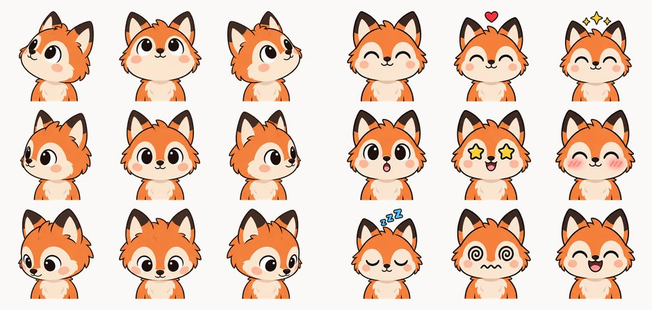</a> <a href="https://github.com/nilbuild/page-mascot/blob/HEAD/.github/styles.png">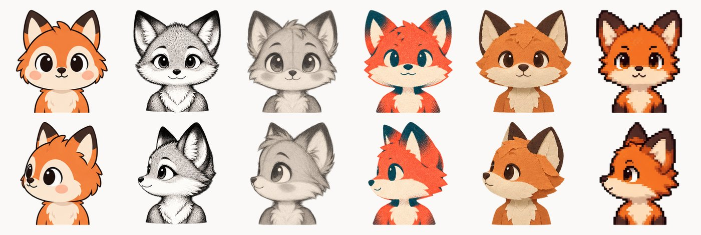</a>

Два листа одного персонажа ([источник](https://github.com/nilbuild/page-mascot/blob/HEAD/.github/sheets.png)) · Один лис в шести стилях ([источник](https://github.com/nilbuild/page-mascot/blob/HEAD/.github/styles.png))

[↑ к каталогу](#каталог)

### 04. Оживить картинку в SpriteCook · `spritecook-animate-assets`

**Хочешь оживить готового персонажа-картинку и написать для этого точный промпт движения — иди сюда.**

- **Что внутри:** 2D, пиксель-арт; работает через сервис SpriteCook; циклы движения из одной картинки
- **Цифры:** установок на skills.sh 1 204, звёзд у репозитория 59
- **Ссылки:** [папка скилла на GitHub](https://github.com/spritecook/skills/tree/HEAD/skills/spritecook-animate-assets) · [страница на skills.sh](https://skills.sh/spritecook/skills/spritecook-animate-assets)
- **Последнее изменение папки скилла:** 20.10.2026
- **Установка:** `npx skills add https://github.com/spritecook/skills --skill spritecook-animate-assets`

> [!NOTE]
> Картинка с сайта сервиса SpriteCook, а не из папки скилла.

<a href="https://www.spritecook.ai/assets/examples/pixel-art-characters/royal-goblin/idle_sheet.png">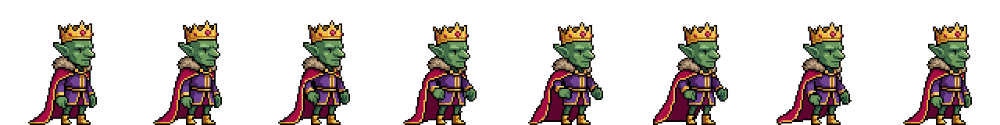</a>

Лист кадров стойки, пример с сайта SpriteCook ([источник](https://www.spritecook.ai/assets/examples/pixel-art-characters/royal-goblin/idle_sheet.png))

[↑ к каталогу](#каталог)

### 05. Короткий мульт на canvas · `animate`

**Хочешь короткий анимированный ролик в одном из готовых стилей (вырезанная бумага, пиксель, скетчбук) — иди сюда.**

- **Что внутри:** 2D; рисуется кодом в браузере, рендер в MP4 через ffmpeg; 7 готовых стилей + свой по референсу
- **Цифры:** установок на skills.sh 350, звёзд у репозитория 1 884
- **Ссылки:** [папка скилла на GitHub](https://github.com/cth9191/animate/tree/HEAD/plugins/animate/skills/animate) · [страница на skills.sh](https://skills.sh/cth9191/animate/animate)
- **Последнее изменение папки скилла:** 05.10.2026
- **Установка:** `npx skills add https://github.com/cth9191/animate --skill animate`

<a href="https://github.com/cth9191/animate/blob/HEAD/docs/styles.png">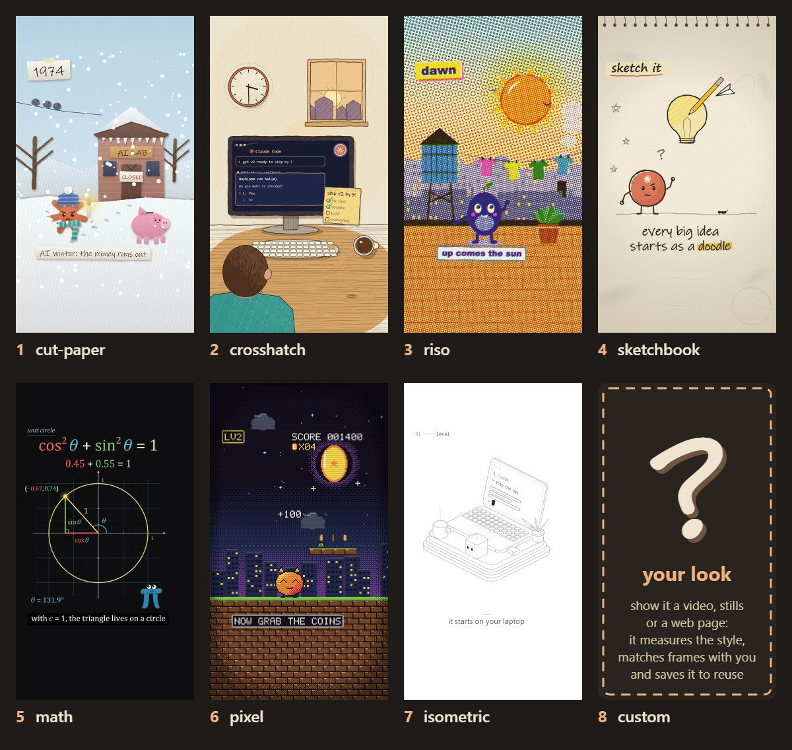</a> <a href="https://github.com/cth9191/animate/blob/HEAD/docs/storyboard.png">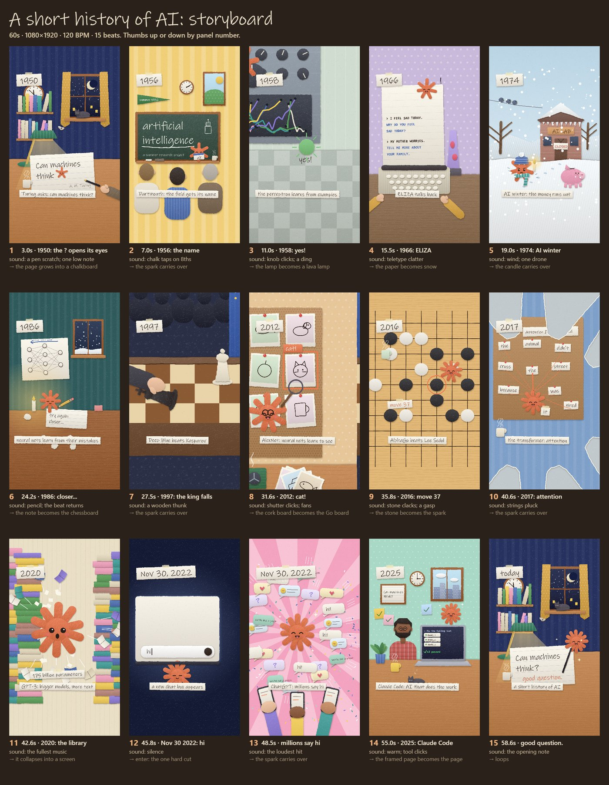</a>

Встроенные стили ([источник](https://github.com/cth9191/animate/blob/HEAD/docs/styles.png)) · Раскадровка ролика ([источник](https://github.com/cth9191/animate/blob/HEAD/docs/storyboard.png))

[↑ к каталогу](#каталог)

### 06. Мультик кодом в 32 стилях · `anidoodle`

**Хочешь рисованный мультик с озвучкой и субтитрами без нейросетей для видео — иди сюда.**

- **Что внутри:** 2D, местами 3D; 32 рисованных стиля; видео и картинки рисуются кодом, каждый рендер одинаковый
- **Цифры:** установок на skills.sh 229, звёзд у репозитория 1 672
- **Ссылки:** [папка скилла на GitHub](https://github.com/alexgreensh/anidoodle/tree/HEAD/skills/anidoodle) · [страница на skills.sh](https://skills.sh/alexgreensh/anidoodle/anidoodle)
- **Последнее изменение папки скилла:** 31.10.2026
- **Установка:** `npx skills add https://github.com/alexgreensh/anidoodle --skill anidoodle`

<a href="https://github.com/alexgreensh/anidoodle/blob/HEAD/assets/styles.jpg">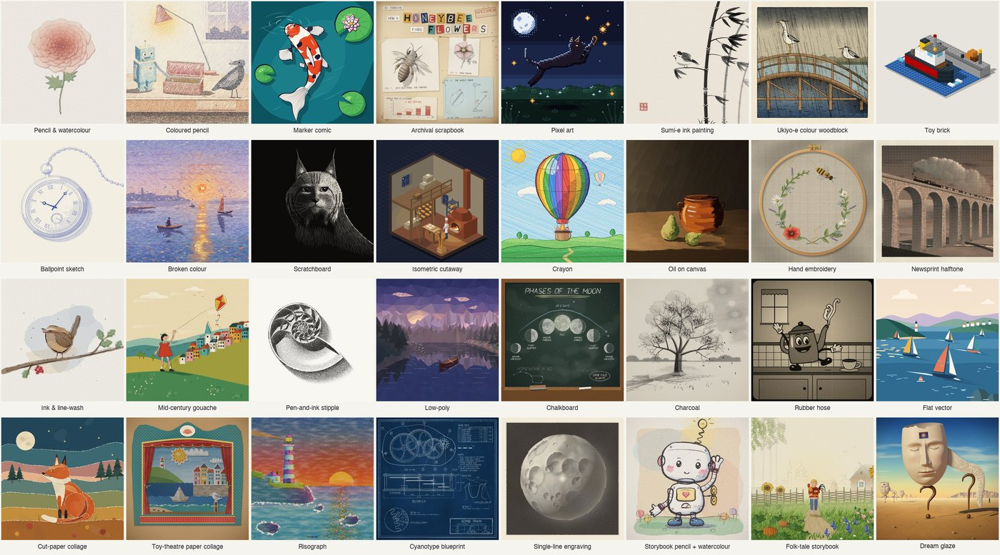</a> <a href="https://github.com/alexgreensh/anidoodle/blob/HEAD/assets/act1.gif">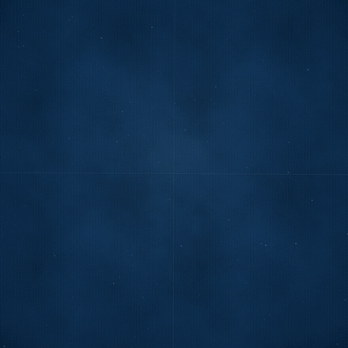</a>

Стили ([источник](https://github.com/alexgreensh/anidoodle/blob/HEAD/assets/styles.jpg)) · Пример ролика ([источник](https://github.com/alexgreensh/anidoodle/blob/HEAD/assets/act1.gif))

[↑ к каталогу](#каталог)

### 07. 2D-персонаж и его движения · `generate2dsprite`

**Хочешь одного 2D-героя и набор его движений (стойка, ходьба, бег, удар, прыжок) — иди сюда.**

- **Что внутри:** 2D, пиксель-арт или HD; один утверждённый кадр героя, потом клипы движений; листы спрайтов для игр и роликов
- **Цифры:** установок на skills.sh 416, звёзд у репозитория 5 725 (звёзды у проекта Agent Sprite Forge из 5 скиллов)
- **Ссылки:** [папка скилла на GitHub](https://github.com/0x0funky/agent-sprite-forge/tree/HEAD/skills/generate2dsprite) · [страница на skills.sh](https://skills.sh/0x0funky/agent-sprite-forge/generate2dsprite)
- **Последнее изменение папки скилла:** 13.11.2026
- **Установка:** `npx skills add https://github.com/0x0funky/agent-sprite-forge --skill generate2dsprite`

<a href="https://github.com/0x0funky/agent-sprite-forge/blob/HEAD/src/v040/aria-set.gif">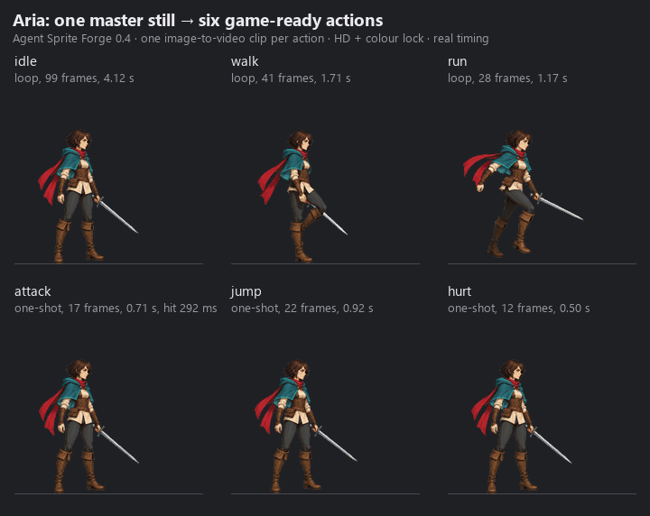</a> <a href="https://github.com/0x0funky/agent-sprite-forge/blob/HEAD/src/v040/aria-in-scene.gif">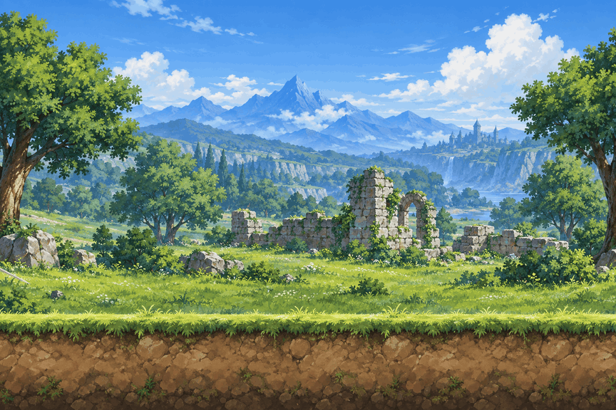</a>

Шесть движений одного героя ([источник](https://github.com/0x0funky/agent-sprite-forge/blob/HEAD/src/v040/aria-set.gif)) · Герой в сцене ([источник](https://github.com/0x0funky/agent-sprite-forge/blob/HEAD/src/v040/aria-in-scene.gif))

[↑ к каталогу](#каталог)

## Без примеров

> [!NOTE]
> У этих скиллов мы не нашли примеров картинок: проверили README, папки репозитория, релизы, сайт проекта и картинки в issues. Скиллы рабочие, просто без витрины.

#### 08. Лист персонажа · `character-design-sheet`

Хочешь, чтобы герой выглядел одинаково во всех кадрах: развороты, эмоции, палитра. Иди сюда.  
**Что внутри:** 2D и 3D; лист персонажа для ИИ-генерации

- **Цифры:** установок на skills.sh 65 357, звёзд у репозитория 23
- **Ссылки:** [папка скилла на GitHub](https://github.com/101-skills/superpowers/tree/HEAD/guides/design/character-design-sheet) · [страница на skills.sh](https://skills.sh/101-skills/superpowers/character-design-sheet)
- **Последнее изменение папки скилла:** 03.08.2026
- **Установка:** `npx skills add https://github.com/101-skills/superpowers --skill character-design-sheet`

#### 09. Раскадровка · `storyboard-creation`

Хочешь грамотную раскадровку и аниматик: планы, ракурсы, правило 180°. Иди сюда.  
**Что внутри:** любой стиль; раскадровка и аниматик (черновой ролик из кадров)

- **Цифры:** установок на skills.sh 65 246, звёзд у репозитория 23
- **Ссылки:** [папка скилла на GitHub](https://github.com/101-skills/superpowers/tree/HEAD/guides/video/storyboard-creation) · [страница на skills.sh](https://skills.sh/101-skills/superpowers/storyboard-creation)
- **Последнее изменение папки скилла:** 03.08.2026
- **Установка:** `npx skills add https://github.com/101-skills/superpowers --skill storyboard-creation`

#### 10. Проверка позы в Blender · `blender-motion-state-inspection`

Хочешь понять, почему персонаж проваливается в пол или смотрит не туда. Иди сюда.  
**Что внутри:** 3D, Blender; риг, позы, перенос анимации

- **Цифры:** установок на skills.sh 8 492, звёзд у репозитория 302 879 (звёзды у всей коллекции ECC)
- **Ссылки:** [папка скилла на GitHub](https://github.com/affaan-m/ecc/tree/HEAD/skills/blender-motion-state-inspection) · [страница на skills.sh](https://skills.sh/affaan-m/ecc/blender-motion-state-inspection)
- **Последнее изменение папки скилла:** 11.06.2026
- **Установка:** `npx skills add https://github.com/affaan-m/ecc --skill blender-motion-state-inspection`

#### 11. Пиксель-арт · `pixel-art-sprites`

Хочешь пиксельного героя и его покадровую анимацию в стиле 8 или 16 бит. Иди сюда.  
**Что внутри:** 2D, пиксель-арт; ограниченная палитра, листы спрайтов

- **Цифры:** установок на skills.sh 3 201, звёзд у репозитория 212
- **Ссылки:** [папка скилла на GitHub](https://github.com/omer-metin/skills-for-antigravity/tree/HEAD/skills/pixel-art-sprites) · [страница на skills.sh](https://skills.sh/omer-metin/skills-for-antigravity/pixel-art-sprites)
- **Последнее изменение папки скилла:** 22.01.2026
- **Установка:** `npx skills add https://github.com/omer-metin/skills-for-antigravity --skill pixel-art-sprites`

> [!WARNING]
> Папку скилла не меняли больше полугода (с 22.01.2026). Скилл может быть заброшен.

#### 12. Ключи в Blender · `blender-animation`

Хочешь ключевые кадры, плавность движений, мимику и виземы в Blender. Иди сюда.  
**Что внутри:** 3D, Blender; ключи, кривые, шейп-кеи, NLA

- **Цифры:** установок на skills.sh 2 195, звёзд у репозитория 163
- **Ссылки:** [папка скилла на GitHub](https://github.com/roble3/cc-blender-skill/tree/HEAD/plugin/skills/blender-animation) · [страница на skills.sh](https://skills.sh/roble3/cc-blender-skill/blender-animation)
- **Последнее изменение папки скилла:** 12.10.2026
- **Установка:** `npx skills add https://github.com/roble3/cc-blender-skill --skill blender-animation`

#### 13. SVG-персонаж · `svg-character-animation`

Хочешь анимировать нарисованного SVG-персонажа кодом. Иди сюда.  
**Что внутри:** 2D, вектор; GSAP, CSS, Remotion

- **Цифры:** установок на skills.sh 2 073, звёзд у репозитория 80 464 (звёзды у всего проекта OpenMontage)
- **Ссылки:** [папка скилла на GitHub](https://github.com/openmontageinc/openmontage/tree/HEAD/.agents/skills/svg-character-animation) · [страница на skills.sh](https://skills.sh/openmontageinc/openmontage/svg-character-animation)
- **Последнее изменение папки скилла:** 28.04.2026
- **Установка:** `npx skills add https://github.com/openmontageinc/openmontage --skill svg-character-animation`

> [!WARNING]
> Папку скилла не меняли больше полугода (с 28.04.2026). Скилл может быть заброшен.

#### 14. Проверка анимации персонажа · `character-animation-qa`

Хочешь проверить готовую анимацию: превью, выборка кадров, проверка видео. Иди сюда.  
**Что внутри:** 2D; Playwright + FFmpeg

- **Цифры:** установок на skills.sh 1 705, звёзд у репозитория 80 464 (звёзды у всего проекта OpenMontage)
- **Ссылки:** [папка скилла на GitHub](https://github.com/openmontageinc/openmontage/tree/HEAD/.agents/skills/character-animation-qa) · [страница на skills.sh](https://skills.sh/openmontageinc/openmontage/character-animation-qa)
- **Последнее изменение папки скилла:** 28.04.2026
- **Установка:** `npx skills add https://github.com/openmontageinc/openmontage --skill character-animation-qa`

> [!WARNING]
> Папку скилла не меняли больше полугода (с 28.04.2026). Скилл может быть заброшен.

#### 15. Библиотека поз · `pose-library-design`

Хочешь набор поз, циклов ходьбы и эмоций, чтобы собирать сцены из готовых частей. Иди сюда.  
**Что внутри:** 2D; позы, циклы, эмоции

- **Цифры:** установок на skills.sh 1 579, звёзд у репозитория 80 464 (звёзды у всего проекта OpenMontage)
- **Ссылки:** [папка скилла на GitHub](https://github.com/openmontageinc/openmontage/tree/HEAD/.agents/skills/pose-library-design) · [страница на skills.sh](https://skills.sh/openmontageinc/openmontage/pose-library-design)
- **Последнее изменение папки скилла:** 28.04.2026
- **Установка:** `npx skills add https://github.com/openmontageinc/openmontage --skill pose-library-design`

> [!WARNING]
> Папку скилла не меняли больше полугода (с 28.04.2026). Скилл может быть заброшен.

#### 16. Blockbench · `blockbench-animation`

Хочешь анимировать низкополигонального 3D-героя: ходьба, стойка, удары. Иди сюда.  
**Что внутри:** 3D, low-poly; Blockbench через MCP

- **Цифры:** установок на skills.sh 1 297, звёзд у репозитория 28
- **Ссылки:** [папка скилла на GitHub](https://github.com/jasonjgardner/blockbench-mcp-project/tree/HEAD/skills/blockbench-animation) · [страница на skills.sh](https://skills.sh/jasonjgardner/blockbench-mcp-project/blockbench-animation)
- **Последнее изменение папки скилла:** 24.09.2026
- **Установка:** `npx skills add https://github.com/jasonjgardner/blockbench-mcp-project --skill blockbench-animation`

#### 17. Риг в Blender · `scenario-blender-rigging`

Хочешь поставить персонажу кости: Rigify, веса, IK/FK, лицевой риг. Иди сюда.  
**Что внутри:** 3D, Blender; риг тела и лица

- **Цифры:** установок на skills.sh 1 121, звёзд у репозитория 3 784 (звёзды у всей коллекции Scenario)
- **Ссылки:** [папка скилла на GitHub](https://github.com/scenario-labs/skills/tree/HEAD/skills/dcc/blender/scenario-blender-rigging) · [страница на skills.sh](https://skills.sh/scenario-labs/skills/scenario-blender-rigging)
- **Последнее изменение папки скилла:** 29.10.2026
- **Установка:** `npx skills add https://github.com/scenario-labs/skills --skill scenario-blender-rigging`

#### 18. Анимация в Blender · `scenario-blender-animation`

Хочешь анимировать героя в Blender: ходьба, прыжок, актёрская сцена, синхрон губ. Иди сюда.  
**Что внутри:** 3D, Blender; от блокинга до полировки

- **Цифры:** установок на skills.sh 1 098, звёзд у репозитория 3 784 (звёзды у всей коллекции Scenario)
- **Ссылки:** [папка скилла на GitHub](https://github.com/scenario-labs/skills/tree/HEAD/skills/dcc/blender/scenario-blender-animation) · [страница на skills.sh](https://skills.sh/scenario-labs/skills/scenario-blender-animation)
- **Последнее изменение папки скилла:** 29.10.2026
- **Установка:** `npx skills add https://github.com/scenario-labs/skills --skill scenario-blender-animation`

#### 19. Спрайт-анимация в Layer · `layer-sprite-animation`

Хочешь циклы движения 2D-героя в 4 или 8 направлениях из одного дизайна. Иди сюда.  
**Что внутри:** 2D; сервис Layer

- **Цифры:** установок на skills.sh 1 045, звёзд у репозитория 9
- **Ссылки:** [папка скилла на GitHub](https://github.com/layerai/skills/tree/HEAD/plugins/layer/skills/layer-sprite-animation) · [страница на skills.sh](https://skills.sh/layerai/skills/layer-sprite-animation)
- **Последнее изменение папки скилла:** 30.10.2026
- **Установка:** `npx skills add https://github.com/layerai/skills --skill layer-sprite-animation`

#### 20. Говорящий персонаж · `layer-talking-characters`

Хочешь, чтобы герой говорил реплики и рот совпадал со звуком. Иди сюда.  
**Что внутри:** синхрон губ; сервис Layer

- **Цифры:** установок на skills.sh 1 039, звёзд у репозитория 9
- **Ссылки:** [папка скилла на GitHub](https://github.com/layerai/skills/tree/HEAD/plugins/layer/skills/layer-talking-characters) · [страница на skills.sh](https://skills.sh/layerai/skills/layer-talking-characters)
- **Последнее изменение папки скилла:** 30.10.2026
- **Установка:** `npx skills add https://github.com/layerai/skills --skill layer-talking-characters`

#### 21. Спрайты и GIF в Scenario · `scenario-sprite-animation`

Хочешь оживить 2D-героя: циклы, листы спрайтов, GIF, покадровый пиксель-арт. Иди сюда.  
**Что внутри:** 2D; сервис Scenario

- **Цифры:** установок на skills.sh 1 038, звёзд у репозитория 3 784 (звёзды у всей коллекции Scenario)
- **Ссылки:** [папка скилла на GitHub](https://github.com/scenario-labs/skills/tree/HEAD/skills/scenario-sprite-animation) · [страница на skills.sh](https://skills.sh/scenario-labs/skills/scenario-sprite-animation)
- **Последнее изменение папки скилла:** 08.11.2026
- **Установка:** `npx skills add https://github.com/scenario-labs/skills --skill scenario-sprite-animation`

#### 22. Вертикальный мульт для Reels · `cartoon-3d-short`

Хочешь мульт на 55–70 с: плоские 2D-герои в цветном 3D-городе, с голосом и музыкой. Иди сюда.  
**Что внутри:** 2D-герои в 3D-мире; three.js + Remotion на своём компьютере; вертикаль 9:16

- **Цифры:** установок на skills.sh 417, звёзд у репозитория 3 378
- **Ссылки:** [папка скилла на GitHub](https://github.com/mromidev/claude-animated-shorts) · [страница на skills.sh](https://skills.sh/mromidev/claude-animated-shorts/cartoon-3d-short)
- **Последнее изменение папки скилла:** 01.11.2026
- **Установка:** `npx skills add https://github.com/mromidev/claude-animated-shorts --skill cartoon-3d-short`

> [!NOTE]
> Картинки в папке references взяты из чужих роликов (автор пишет «for style study only»), поэтому их здесь нет.

#### 23. 12 принципов Disney · `disney-animation-rule-skill`

Хочешь, чтобы движение не было деревянным: сжатие-растяжение, упреждение, дуги. Иди сюда.  
**Что внутри:** анимация кодом; 12 принципов Disney

- **Цифры:** установок на skills.sh 900, звёзд у репозитория 1 655 (звёзды у всей коллекции vibe-motion)
- **Ссылки:** [папка скилла на GitHub](https://github.com/vibe-motion/skills/tree/HEAD/disney-animation-rule-skill) · [страница на skills.sh](https://skills.sh/vibe-motion/skills/disney-animation-rule-skill)
- **Последнее изменение папки скилла:** 12.06.2026
- **Установка:** `npx skills add https://github.com/vibe-motion/skills --skill disney-animation-rule-skill`

#### 24. Раскадровка в Scenario · `scenario-storyboards`

Хочешь раскадровку или аниматик, где герои одинаковые от кадра к кадру. Иди сюда.  
**Что внутри:** раскадровка, комикс, аниматик; сервис Scenario

- **Цифры:** установок на skills.sh 890, звёзд у репозитория 3 784 (звёзды у всей коллекции Scenario)
- **Ссылки:** [папка скилла на GitHub](https://github.com/scenario-labs/skills/tree/HEAD/skills/scenario-storyboards) · [страница на skills.sh](https://skills.sh/scenario-labs/skills/scenario-storyboards)
- **Последнее изменение папки скилла:** 29.10.2026
- **Установка:** `npx skills add https://github.com/scenario-labs/skills --skill scenario-storyboards`

#### 25. Рисованная анимация в Blender · `scenario-blender-grease-pencil`

Хочешь покадровую 2D-анимацию или перекладку в Blender Grease Pencil. Иди сюда.  
**Что внутри:** 2D в Blender; покадрово, перекладка, кальки

- **Цифры:** установок на skills.sh 842, звёзд у репозитория 3 784 (звёзды у всей коллекции Scenario)
- **Ссылки:** [папка скилла на GitHub](https://github.com/scenario-labs/skills/tree/HEAD/skills/dcc/blender/scenario-blender-grease-pencil) · [страница на skills.sh](https://skills.sh/scenario-labs/skills/scenario-blender-grease-pencil)
- **Последнее изменение папки скилла:** 29.10.2026
- **Установка:** `npx skills add https://github.com/scenario-labs/skills --skill scenario-blender-grease-pencil`

#### 26. Аниме-стиль в Blender · `anime-style`

Хочешь 3D-героя в стиле аниме: плоские тени, чёткий силуэт. Иди сюда.  
**Что внутри:** 3D, Blender; тун-шейдинг

- **Цифры:** установок на skills.sh 498, звёзд у репозитория 2 967 (звёзды у всей коллекции Blender-скиллов)
- **Ссылки:** [папка скилла на GitHub](https://github.com/arjun988/blender-skills/tree/HEAD/.claude/skills/anime-style) · [страница на skills.sh](https://skills.sh/arjun988/blender-skills/anime-style)
- **Последнее изменение папки скилла:** 10.07.2026
- **Установка:** `npx skills add https://github.com/arjun988/blender-skills --skill anime-style`

#### 27. Мультяшный стиль в Blender · `cartoon-style`

Хочешь мультяшного 3D-героя: крупные формы, яркая палитра. Иди сюда.  
**Что внутри:** 3D, Blender; стилизация

- **Цифры:** установок на skills.sh 486, звёзд у репозитория 2 967 (звёзды у всей коллекции Blender-скиллов)
- **Ссылки:** [папка скилла на GitHub](https://github.com/arjun988/blender-skills/tree/HEAD/.claude/skills/cartoon-style) · [страница на skills.sh](https://skills.sh/arjun988/blender-skills/cartoon-style)
- **Последнее изменение папки скилла:** 10.07.2026
- **Установка:** `npx skills add https://github.com/arjun988/blender-skills --skill cartoon-style`

#### 28. Стоп-моушн в Blender · `stop-motion-craft-style`

Хочешь вид пластилина, бумаги или войлока и рывками, как в стоп-моушне. Иди сюда.  
**Что внутри:** 3D, Blender; пластилин, бумага, войлок

- **Цифры:** установок на skills.sh 449, звёзд у репозитория 2 967 (звёзды у всей коллекции Blender-скиллов)
- **Ссылки:** [папка скилла на GitHub](https://github.com/arjun988/blender-skills/tree/HEAD/.claude/skills/stop-motion-craft-style) · [страница на skills.sh](https://skills.sh/arjun988/blender-skills/stop-motion-craft-style)
- **Последнее изменение папки скилла:** 10.07.2026
- **Установка:** `npx skills add https://github.com/arjun988/blender-skills --skill stop-motion-craft-style`

#### 29. Мимика и губы в Blender · `blender-facial-shapekeys`

Хочешь, чтобы 3D-персонаж в Blender говорил и строил рожицы — иди сюда. Иди сюда.  
**Что внутри:** 3D, Blender; лицевой риг: кости или шейп-кеи (ARKit 52); виземы для синхрона губ

- **Цифры:** установок на skills.sh 426, звёзд у репозитория 1 116 (звёзды у всей коллекции из 30 скиллов Blender)
- **Ссылки:** [папка скилла на GitHub](https://github.com/el4cteo/blender-skills/tree/HEAD/skills/blender-facial-shapekeys) · [страница на skills.sh](https://skills.sh/el4cteo/blender-skills/blender-facial-shapekeys)
- **Последнее изменение папки скилла:** 13.11.2026
- **Установка:** `npx skills add https://github.com/el4cteo/blender-skills --skill blender-facial-shapekeys`

> [!NOTE]
> Отдельного примера мимики нет: в проекте blender-skills есть только видео рига и ходьбы.

#### 30. Анимация в Maya · `scenario-maya-animation`

Хочешь анимировать героя в Maya: циклы, актёрская игра, синхрон губ. Иди сюда.  
**Что внутри:** 3D, Maya; от блокинга до полировки

- **Цифры:** установок на skills.sh 413, звёзд у репозитория 3 784 (звёзды у всей коллекции Scenario)
- **Ссылки:** [папка скилла на GitHub](https://github.com/scenario-labs/skills/tree/HEAD/skills/dcc/maya/scenario-maya-animation) · [страница на skills.sh](https://skills.sh/scenario-labs/skills/scenario-maya-animation)
- **Последнее изменение папки скилла:** 05.11.2026
- **Установка:** `npx skills add https://github.com/scenario-labs/skills --skill scenario-maya-animation`

## Что делать

**Как выбрать скилл под задачу**

- [ ] Нужен готовый мульт целиком? Смотри [01](#s01), [02](#s02), [05](#s05), [06](#s06), [22](#s22).
- [ ] Нужен 2D-герой с движениями (ходьба, бег, удар)? Смотри [04](#s04), [07](#s07), [11](#s11), [13](#s13), [15](#s15), [19](#s19), [21](#s21).
- [ ] Работаешь в Blender или Maya? Смотри [10](#s10), [12](#s12), [17](#s17), [18](#s18), [25](#s25), [29](#s29), [30](#s30).
- [ ] Нужно, чтобы герой говорил? Смотри [20](#s20), [29](#s29).
- [ ] Сначала придумать историю и кадры? Смотри [08](#s08), [09](#s09), [24](#s24).
- [ ] Движения деревянные? Смотри [14](#s14), [23](#s23).
- [ ] Проверь дату последнего изменения: свежий скилл надёжнее.
- [ ] Посмотри, нужен ли платный сервис: скиллы Scenario, Layer, SpriteCook и MiniMax работают через свои сервисы.

**Как поставить скилл**

- [ ] Поставь [Node.js](https://nodejs.org/): без него команда `npx` не запустится.
- [ ] Открой терминал в папке своего проекта.
- [ ] Скопируй строку «Установка» из карточки скилла и запусти её.
- [ ] Открой своего агента (Claude Code, Cursor, Codex) и опиши задачу словами: агент сам подхватит скилл.

[↑ к каталогу](#каталог)
